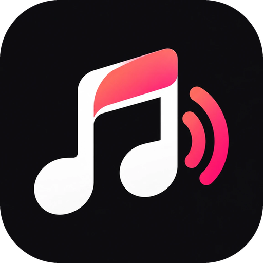
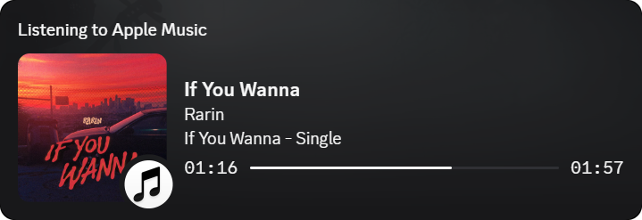
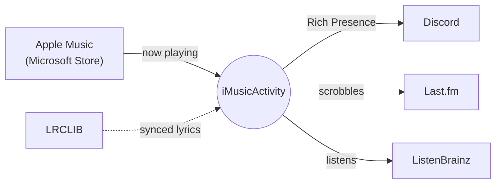

<div align="center">



# iMusicActivity

### Apple Music on Windows, live on your Discord profile.

A lightweight tray app that turns whatever you're playing in Apple Music<br>
into Discord Rich Presence, synced lyrics, and Last.fm / ListenBrainz scrobbles.

<br>

<a href="https://github.com/Suraj64x/AppleMusicActivity/releases/latest/download/iMusicActivity.exe"></a>
<a href="https://github.com/Suraj64x/AppleMusicActivity/releases"></a>


<br><br>



</div>

<br>

## Features

| | |
|:--|:--|
| **Rich Presence** | Song, artist, album, artwork and a live progress bar, with *Listen on Apple Music* and *View Artist* buttons. |
| **Synced lyrics** | Shows the current line in your status, pulled from [LRCLIB](https://lrclib.net) and cached locally. |
| **Scrobbling** | Last.fm and ListenBrainz, with optional clean-up of "Single", "EP" and "(Mixed)" style suffixes. |
| **Classical aware** | Optionally credits the composer instead of the performer. |
| **Stays out of the way** | Lives in the system tray, can start with Windows, and checks for updates on launch. |
| **Private by default** | Credentials are stored in Windows Credential Manager, never in plain text. |
| **Localised** | English, Deutsch, Español, Español (Latinoamérica), 日本語, 한국어, Русский, Türkçe. |

## How it works



iMusicActivity reads the now-playing state from the Apple Music app, adds artwork and metadata from the Apple Music web catalog, then sends it on to the services you turn on.

## Quick start

1. Install [Apple Music from the Microsoft Store](https://apps.microsoft.com/detail/9PFHDD62MXS1).
2. Install the [.NET 10 Desktop Runtime](https://dotnet.microsoft.com/en-us/download/dotnet/10.0) if Windows asks for it.
3. [Download `iMusicActivity.exe`](https://github.com/Suraj64x/AppleMusicActivity/releases/latest/download/iMusicActivity.exe) and run it.
4. In Discord, open **Settings → Activity Privacy** and turn on **Share my activity**.

Play a song and your status updates within a few seconds. Double-click the tray icon to open **Settings**.

> [!TIP]
> Keep Apple Music and iMusicActivity on the same virtual desktop. The app can only see an Apple Music window on the desktop it's running on.

## Configuration

Everything lives in the Settings window, which you open by double-clicking the tray icon.

<details>
<summary><b>Discord Rich Presence</b></summary>
<br>

- Choose whether your status reads **Apple Music**, the **artist name** or the **song name**.
- Toggle album artwork, album title, the Apple Music badge, and whether to stay visible while paused.
- Set your **Apple Music region** (for example `US`, `GB`, `JP`) so artwork and links match your storefront.

</details>

<details>
<summary><b>Synced lyrics</b></summary>
<br>

- Turn on **Show song lyrics in Rich Presence** to show the current line as your status.
- **Keep lyrics during instrumental breaks** holds the last line instead of clearing it.
- Lyrics are cached on disk. You can view or clear the cache from Settings.

</details>

<details>
<summary><b>Last.fm</b></summary>
<br>

1. Create an API account at [last.fm/api/account/create](https://www.last.fm/api/account/create).
2. Paste the **API key** and **shared secret**, then your Last.fm **username** and **password**.
3. Click **Save credentials**. iMusicActivity checks them right away.

</details>

<details>
<summary><b>ListenBrainz</b></summary>
<br>

1. Copy your user token from [listenbrainz.org/settings](https://listenbrainz.org/settings/).
2. Paste it into **User token** and click **Save credentials**.

</details>

> [!NOTE]
> Scrobbles are sent live. Listens played while you're offline are not queued.

## Troubleshooting

<details>
<summary><b>My Discord status doesn't show up</b></summary>
<br>

- Make sure **Share my activity** is on in Discord, and that you're using the desktop Discord app.
- Check that Apple Music is the Microsoft Store version and is on the same virtual desktop.
- Choose **Exit** from the tray menu, then start iMusicActivity again.

</details>

<details>
<summary><b>Artwork or links point to the wrong song</b></summary>
<br>

Set **Apple Music region** in Settings to the country of your Apple Account.

</details>

<details>
<summary><b>Where are the logs?</b></summary>
<br>

`%localappdata%\iMusicActivity`. Please attach them when you [open an issue](https://github.com/Suraj64x/AppleMusicActivity/issues).

</details>

## Build from source

You need Windows 11 and the [.NET 10 SDK](https://dotnet.microsoft.com/en-us/download/dotnet/10.0).

```bash
git clone https://github.com/Suraj64x/AppleMusicActivity.git
cd AppleMusicActivity
dotnet publish iMusicActivity/iMusicActivity.csproj -c Release -r win-x64 --self-contained false -p:PublishSingleFile=true
```

The single-file `iMusicActivity.exe` is copied to the repository root. `BuildReleases.ps1` runs the same command.

## Contributing

Issues and pull requests are welcome. See [CONTRIBUTING.md](CONTRIBUTING.md) and [SECURITY.md](SECURITY.md).

## License

[GPL-3.0](LICENSE). iMusicActivity is built on [AMWin-RP](https://github.com/PKBeam/AMWin-RP) by Vincent Liu (PKBeam) and its contributors.

iMusicActivity isn't affiliated with Apple or Discord. Apple Music is a trademark of Apple Inc.

---

<div align="center">

<br>


**iMusicActivity**<br>
<sub>Apple Music on Windows, live on Discord.</sub>

<sub><a href="https://github.com/Suraj64x/AppleMusicActivity/releases/latest">Download</a> &nbsp;·&nbsp; <a href="https://github.com/Suraj64x/AppleMusicActivity/issues">Report an issue</a> &nbsp;·&nbsp; Made by <b>SMOKiE</b></sub>

</div>
